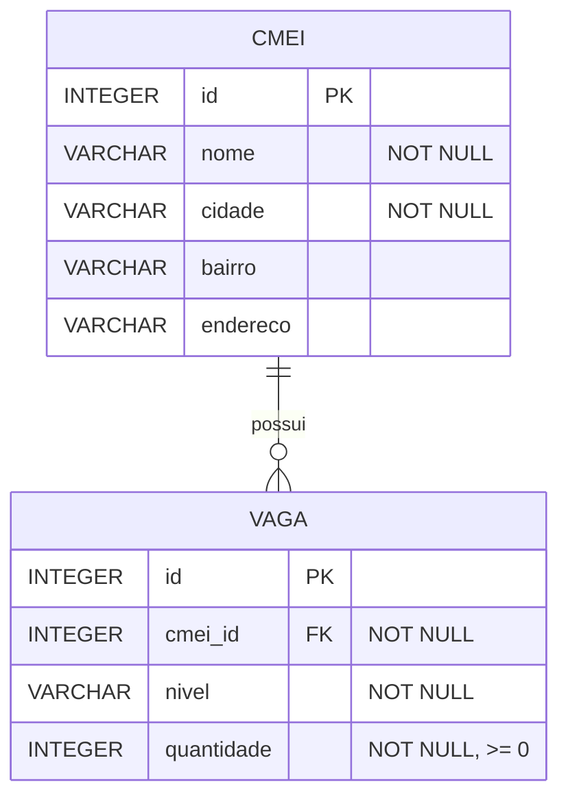

# Cadastro de CMEIs

Sistema desktop em Java para cadastrar os CMEIs (Centros Municipais de Educação Infantil) de Santa Tereza do Oeste. Usa Swing na interface e JDBC com PostgreSQL para gravar os dados.

## Funcionalidades

- **Salvar**: cadastra um novo CMEI
- **Buscar**: procura um CMEI pelo id e preenche os campos
- **Alterar**: atualiza os dados de um CMEI já cadastrado
- **Deletar**: exclui um CMEI (pede confirmação)
- **Listar**: mostra todos os CMEIs na tabela
- **Limpar**: limpa os campos

Clicando em uma linha da tabela, os dados do CMEI vão para os campos.

## Validações

- O id é obrigatório e deve ser um número inteiro maior que zero
- Não é possível cadastrar dois CMEIs com o mesmo id
- Nome e cidade são obrigatórios
- O nome pode ter no máximo 100 caracteres
- Não é possível excluir um CMEI que tenha vagas cadastradas
- Erros de conexão com o banco mostram uma mensagem na tela

## DER



Um CMEI pode ter várias vagas (uma por nível). A tabela `vaga` tem uma chave estrangeira (`cmei_id`) para a tabela `cmei`, por isso um CMEI com vagas cadastradas não pode ser excluído.

## Banco de dados

- `scriptBanco.sql`: cria as tabelas `cmei` e `vaga`
- `dadosExemplo.sql`: insere os dados iniciais

```bash
createdb cadastro_cmei
psql -d cadastro_cmei -f scriptBanco.sql
psql -d cadastro_cmei -f dadosExemplo.sql
```

A URL do PostgreSQL fica na classe `Conexao`. Defina as variáveis de ambiente `CMEI_DB_USER` e `CMEI_DB_PASSWORD` no ambiente que executa a aplicação.

## Como executar

1. Criar o banco com os scripts acima
2. Rodar a classe `TestaConexao` para conferir a conexão
3. Rodar a classe `Inicia` para abrir a tela

A classe `Main` faz uma demonstração das operações no console.

## Estrutura

```
src/main/java/br/senac/pr
├── Inicia.java          abre a tela
├── Main.java            demonstração no console
├── TestaConexao.java    testa a conexão com o banco
├── jdbc
│   ├── Conexao.java     conexão com o PostgreSQL
│   └── CmeiDAO.java     inserir, buscar, alterar, deletar e listar
├── modelo
│   ├── Cmei.java        classe do CMEI com as validações
│   └── Vaga.java        classe da vaga de um CMEI
└── visao
    └── TelaCmei.java    tela de cadastro
```

## Tecnologias

- Java
- Swing
- JDBC
- PostgreSQL
- Maven
